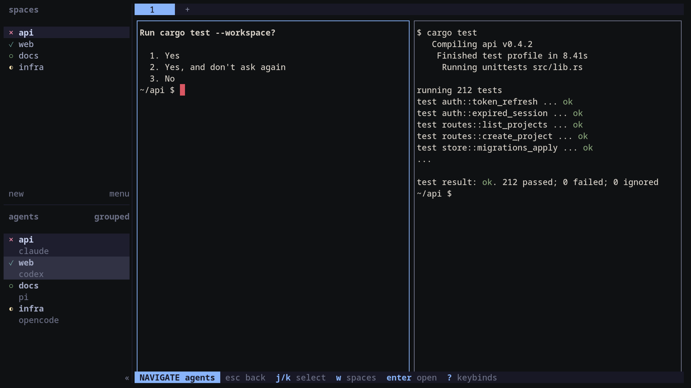

# mherdr

Personal fork of [herdr](https://github.com/herdrdev/herdr): rendering as
responsive as a plain terminal, vim-style navigation for spaces and agents.
Everything else works as in herdr ([README](https://github.com/herdrdev/herdr#readme),
[docs](https://herdr.dev/docs/)).



## What's different

| feature                | how                                                                  |
| ---------------------- | -------------------------------------------------------------------- |
| **vim navigation**     | `prefix+w` spaces, `prefix+a` agents; `j`/`k` move, `enter` opens    |
| **next waiting agent** | `prefix+i` jumps to blocked, then finished agents; again to cycle    |
| **adaptive fps**       | `max_fps` while you type or scroll, 60 fps when agents only print    |
| **faster rendering**   | less copying per frame, wheel scrolling without full redraws, LTO    |

**Key change:** pane focus up/down is `ctrl+j`/`ctrl+k`, because `j`/`k` drive
the lists.

## Measured

Against upstream herdr, 2026-11-20 ([method](MHERDR.md#measurements)):

| test                              | herdr    | mherdr   | effect                      |
| --------------------------------- | -------- | -------- | --------------------------- |
| tab switch until new frame        | 13.5 ms  | 6.7 ms   | **2× faster**               |
| wheel step until frame            | 9.1 ms   | 2.5 ms   | **3.6× faster**             |
| scroll steps drawn (125 per s)    | 58 / s   | 125 / s  | **every step, none skipped** |
| keypress until echo               | 5.6 ms   | 2.0 ms   | **2.8× faster**             |
| CPU while an agent prints         | 41 %     | 16 %     | **−60 % CPU**               |

## Configure

In `~/.config/herdr/config.toml`:

```toml
[advanced]
max_fps = 144              # display refresh rate; default 60, range 30–240

[keys]                     # optional: j/k back to panes, lists on arrows
navigate_workspace_up = "up"
navigate_workspace_down = "down"
navigate_pane_down = "j"
navigate_pane_up = "k"
```

Apply with `mherdr server reload-config`.

## Install

Prebuilt for Linux (x86_64, aarch64) and macOS (x86_64, arm64) on the
[releases page](https://github.com/mi-uh/mherdr/releases):

```bash
curl -fLo ~/.local/bin/mherdr \
  https://github.com/mi-uh/mherdr/releases/latest/download/mherdr-linux-x86_64
chmod +x ~/.local/bin/mherdr
```

**macOS:** unsigned; run `xattr -d com.apple.quarantine mherdr` once.

## Build from source

**Requires:** Rust (version from `rust-toolchain.toml`), Zig 0.16.0.

```bash
cargo build --release                           # fat LTO: 20+ minutes
ln -sf "$PWD/target/release/herdr" ~/.local/bin/mherdr
mherdr server stop                              # load the new build
mherdr
```

**Caution:** `server stop` ends all panes and agents of the session.

**Update:** `git pull`, then build again. `herdr update` is disabled, it would
install upstream herdr.

## Run next to herdr

Both share config and default session. Separate session:

```bash
mherdr --session m
mherdr --session m server stop
```

## License

Apache 2.0, like herdr: [LICENSE](LICENSE).
